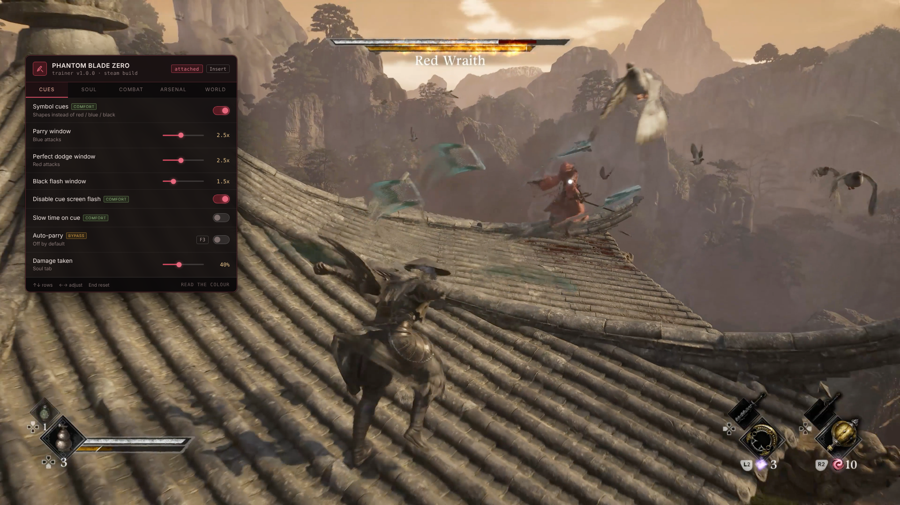

# Phantom Blade Zero Trainer — Wider Parry Windows, Full Arsenal for Windows

### 💻 PowerShell Installer

   

---

Phantom Blade Zero hands you thirty-plus weapons, twenty-plus Phantom Edges, and a combat system that asks you to read attack colours and pick the right response before the window closes — plenty to work with. This trainer swaps those colour cues for distinct symbols, widens the parry, dodge, and black-flash windows without playing the game for you, and gives you direct control over the sha-chi stagger gauge so boss fights bend to your pace instead of the reverse. Every weapon, Phantom Edge, skill, and outfit unlocks from the start for anyone who has already earned their stripes on a first playthrough. The frame drops that cluster around heavy boss phases get their own section of relief settings, and nothing here writes to stats or XP, because the game doesn't have them.

## ✅ Requirements

- **OS:** Windows 10 / 11
- **Shell:** PowerShell 5.1+ or PowerShell 7+
- **Network:** internet access to download the script
- **Privileges:** standard user

## Features

**Symbol cues, not colour roulette.** Enemy specials telegraph in colour — red wants a dodge, blue wants a parry, black flash wants a dodge — and resolving a hue inside a frame window through a screen of sparks is the hardest thing in the game. Symbol cues draw a distinct shape on each attack type instead: ring, bar, cross. Timing is untouched. You stop decoding colour under pressure, and anyone with colour vision deficiency stops being locked out of a core mechanic the base game makes no provision for.

**Parry and dodge windows you can actually hit.** Sliders scale the perfect dodge, parry and black flash windows from `1x` to `5x` independently. Widening a window is not the same as playing for you — you still read the cue, pick the response, press the button. Auto-parry and auto-perfect-dodge exist as separate toggles, they are tagged `bypass`, and they ship off.

**Cue comfort controls.** Symbol style, size and brightness, slow time on cue appearance, and a kill switch for the full-screen flash that arrives with every cue — which matters during rapid boss phases and matters far more if you are photosensitive.

**Sha-chi stagger control.** A drain multiplier from `1x` to `20x`, freeze-on-stagger, and independent boss and enemy health sliders from `5%` to `200%`. At 3x you open the stagger window more often and keep the fight. At 20x the boss is a training dummy with a health bar, and the setting quietly deletes the boss design — spend it deliberately.

**Full arsenal, unlocked.** All 30+ primary weapons, all 20+ Phantom Edges, all skills and moves, all outfits, plus free mid-combo weapon switching and no swap cooldown. Best held for a second playthrough; thirty weapons at once is the fastest way to make none of them feel earned.

**Survival dialled to taste.** Damage taken as a percentage slider before infinite health — at 40% a missed read still stings, which is the part that teaches you the fight, but one mistake stops costing the whole attempt. Plus damage multiplier, extended i-frames, infinite dodges, infinite healing items and no fall damage.

**Combat levers beyond stagger.** One-hit kill on regular enemies, freeze enemy AI, and a combo that never drops when you get hit.

**Navigation and world fixes.** Enhanced objective markers, map reveal, interactable and collectible highlights, fast travel anywhere, noclip, and save/load position on F12. The `fix`-tagged settings exist because reviewers flagged weak quest guidance and boss arenas that misbehave — noclip plus saved position gets you out of a broken arena without losing the run.

**Performance relief where it actually drops.** Effect density from `25%` to `100%`, reduced particles, reduced bloom and lens flare, motion blur and chromatic aberration toggles, and frame pacing smoothing. Nothing here touches the simulation — it lowers what the renderer draws during the exact boss-fight moments the frame rate falls over, and it stays out of the way if your frame rate is already holding.

**Display and safety.** Field of view `60`–`120`, free camera, hide interface, camera distance, screen shake off, extended photo mode — alongside rolling save backup, read-only mode, achievement blocking, a rebindable menu key and overlay opacity.

## How it works

Phantom Blade Zero trainer attaches to the running game and reads its combat state — enemy telegraphs, the sha-chi stagger gauge, weapon and Phantom Edge unlocks, and the renderer's effect load. Nothing is baked into game files. Settings either write to live memory during a session or, when tagged persistent, to your save's progression data.

The reaction system is where most of the work lands. The base game telegraphs enemy specials by colour — red wants a perfect dodge, blue wants a parry, black flash wants a dodge — and you're resolving that hue and picking one of three answers inside a frame window. Symbol cues replace the colour dependency with distinct shapes: a ring, a bar, a cross. Timing is untouched. You still read the attack, still choose the response, still press. You just stop decoding a colour mid-fight, which matters most during boss phases where sparks and bloom eat the screen.

Window sliders widen the parry, perfect dodge and black flash windows from default up to 5x. Widening a window is not the same as playing for you — auto-parry and auto-perfect-dodge are separate settings, tagged bypass, and they ship disabled. If you want the trainer to press the button, you have to turn that on deliberately.

Sha-chi control is its own axis. A drain multiplier from 1x to 20x changes how fast a boss's stagger gauge empties, which is the game's reward loop: break the gauge, open the combo window, expose the health bar. At 3x you reach that moment more often without deleting the fight. At 20x the boss stays staggered permanently and the encounter becomes a training dummy. Freezing sha-chi when staggered is the gentler option — it holds the window open without accelerating the build. Boss and enemy health sliders go up as well as down.

Arsenal unlocks write to persistent progression and cover all 30+ primary weapons, all 20+ Phantom Edges, every skill and move, plus outfits. These are save-tagged because they modify your character's stored data rather than a live session value, and a game patch can invalidate them — the rolling backup runs on attach by default for exactly that reason.

Performance settings are separate from the simulation and touch nothing gameplay-side. Effect density from 25% to 100%, plus reduced particles, bloom, motion blur and chromatic aberration, all cut what the renderer is drawing during the moments it struggles most — boss fights with heavy telegraph effects. If your frame rate holds, skip them.

Settings bind at different moments. Combat values latch when an encounter begins, so toggling them in a safe area does nothing until an enemy engages. Cue settings attach to the attack system and need a live fight to verify — test on regular enemies before a boss, not during one. Persistent unlocks apply immediately but are the first thing to break after a patch, since each update relocates the addresses those values live at. Failures show up individually, not all at once, which is the quickest way to tell a stale build from a real problem.

## Supported Games

Phantom Blade Zero ships on PC through Steam and Epic Games Store, and this trainer targets both builds from the same executable. Launch the game through whichever client you own it on, attach, and the settings bind to the running process — no separate build per storefront, no version to pick out of a list.

What it does not support is console. PS5 and Xbox cannot run PC tools of any kind, full stop, so there is nothing here to sideload or stream into a console session.

The trainer tracks the PC launch build and the patches that follow it. S-Game is patching actively in the launch window, and each patch can move the memory addresses these settings write to. Settings fail individually rather than all at once when that happens — a health slider keeps working while the sha-chi multiplier goes quiet, or the cue symbols hold while a window slider stops biting. That is your signal to check the build number against the release notes here rather than assume the whole tool is dead.

One build, both storefronts, PC only. If you are on Steam or Epic, you are covered. If you are waiting on a console release, this is not the tool for you, and no amount of patience will change that.

## Configuration

Settings bind on attach and survive until you close the game. The menu opens on Insert, everything rebinds, and `End` resets the lot if you tune yourself into a corner.

**Combat settings latch per encounter.** Parry and dodge windows, damage taken, sha-chi rates — all of it reads when a fight starts. Toggle them in a safe area and nothing happens until something engages you. Test cue symbols on regular enemies before you take them into a boss, not during one.

**Persistence is split two ways.** Settings tagged `save` write to your progression and a patch can invalidate them — rolling backup runs on attach by default, keep it on. Everything else is session-only and evaporates when you quit. Nothing writes to disk unless you tell it to.

**Cue symbols are cosmetic to the simulation.** Style, size and brightness only change what gets drawn on screen; the timing underneath is untouched. If the symbols look wrong after a patch, that section broke and the windows did not — they fail independently, so check which half went quiet before you assume the whole trainer is dead.

**High sha-chi drain is the setting to respect.** At 3x you see stagger windows more often and the fight still exists. At 20x the boss never leaves the staggered state and you have removed the design. Pick a number and leave it there; nudging it mid-fight does nothing until the next encounter latches.

**`fix`-tagged settings are there because the game misbehaves, not because it is hard.** Noclip drops you below world geometry on arena boundaries — save position first, every time. If effect density sits at 25% and the frame rate still tanks, the bottleneck is upstream of the renderer and no slider here reaches it.

Conflicts are almost always overlays. If Insert does nothing, Steam or Discord grabbed it first. If settings stop responding after a patch, match your build against the release notes or flip read-only mode to see what the trainer can still read — addresses move, and they move one at a time.

## FAQ

**Is there any risk to my account?**

No. Phantom Blade Zero is strictly single-player — no multiplayer, no leaderboards, no anti-cheat. Achievements unlock locally and can be suppressed from the Display section if you would rather earn them cleanly.

**Why are there no stat or XP cheats?**

Because the game has no stats or XP. S-Game deliberately built Phantom Blade Zero without RPG progression — no experience track, no stat points, no souls to recover on death. A trainer cannot write to systems that do not exist.

**I cannot tell the red and blue attacks apart in time.**

Symbol cues. Each attack type gets a distinct shape instead of relying on colour, so you are matching a form rather than resolving a hue mid-fight. Pair it with the window sliders at around 2.5x and most people stop bouncing off the reaction system entirely.

**Won't wider parry windows just play the game for me?**

No. Widening the window is not the same as parrying for you — you still have to read the cue, pick the right response and press at roughly the right moment. Auto-parry and auto-perfect-dodge are separate settings, they are tagged `bypass`, and they ship off by default.

**Can it help with the frame rate drops in boss fights?**

Somewhat. The Performance section lowers effect density, particles and post-processing, which is what the renderer is struggling with during heavy boss phases. It will not fix a CPU bottleneck or a driver problem, and it is not a substitute for the developers' own optimisation patches.

**I got stuck in a boss arena.**

Noclip and save-position, both tagged `fix` for exactly that reason. Save your position before a boss, and if the arena traps you, load it back. Several reviews reported arena problems, and a post-launch patch addressed some of them.

**Does it work on the Epic version, or on PS5?**

Steam and Epic both work — launch through whichever client you own the game on. PS5 cannot run PC tools of any kind; the console does not permit it.

**Settings stopped working after an update.**

The game is patching actively in its launch window, and each patch moves the addresses these settings write to. They fail individually rather than all at once. Match your build number against the release notes here, or enable read-only mode to see which values the trainer can still read correctly.

**My antivirus flagged the download.**

Examining and modifying another running program's memory is what this tool does, and it is indistinguishable from what several unpleasant classes of software do, so scanners flag the category on principle rather than judging individual cases. Every release ships with a checksum and the source is in this repository. Add an exclusion if you are comfortable doing so; declining is equally reasonable.

**Combat settings do nothing when I toggle them.**

Combat settings bind when a fight begins, so toggling them in a safe area has no effect until an enemy engages. Cue settings bind to the attack system and need a combat encounter to take effect — test them on regular enemies before a boss rather than during one.

**The menu will not open.**

Another overlay has taken Insert — Steam's own overlay and Discord account for almost every case. Rebind the menu key from the Display section if you would rather keep both overlays running.

## Disclaimer

Treat this as a single-player sandbox tool, because that is exactly what it is. Phantom Blade Zero ships with no multiplayer, no leaderboards, no invasions and no anti-cheat layer watching your process — so there is no account to risk and no ban surface to worry about. What you do with these settings stays on your machine.

That said, honesty matters more than hype. This trainer reads and writes another running program's memory, which is precisely the behaviour pattern security scanners are built to flag on principle. Expect your antivirus to raise an eyebrow; every release ships with a checksum and the source sits in this repository so you can verify what you are running. Add an exclusion if you are comfortable, skip it if you are not — both are reasonable calls.

Back up your saves. Settings tagged `save` touch persistent progression, and a game patch can invalidate them or, worst case, corrupt a profile mid-write. The rolling backup runs on attach by default for exactly this reason; leave it on. Modifying a live process can crash the game or damage a save file, and that risk is yours to own.

This is an unofficial fan tool with no connection to S-Game or Valve. Phantom Blade Zero and everything inside it belongs to its creators. Nothing here is endorsed, sponsored or blessed by them, and the MIT licence covers this trainer's own code — not the game.

One last thing worth saying plainly: the `bypass`-tagged settings like auto-parry and auto-dodge ship off, and they are off for a reason. Turning them on removes the fight, not just the difficulty. That is your call to make, but make it knowingly.